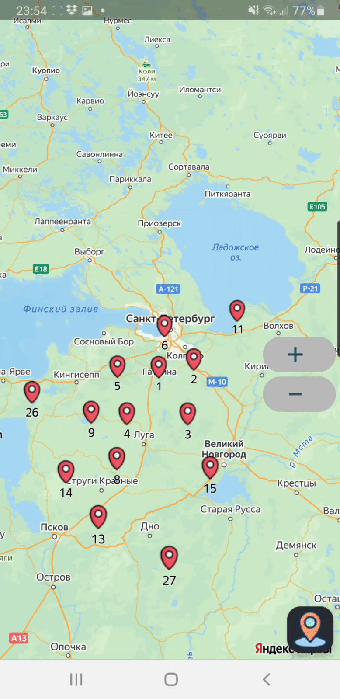
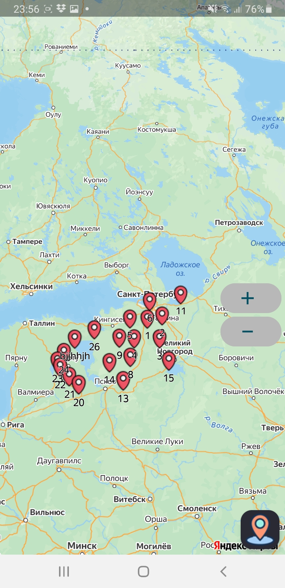
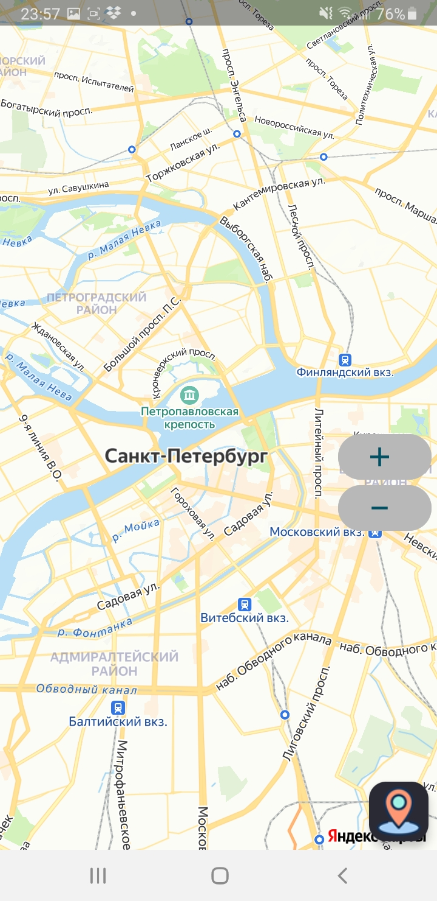
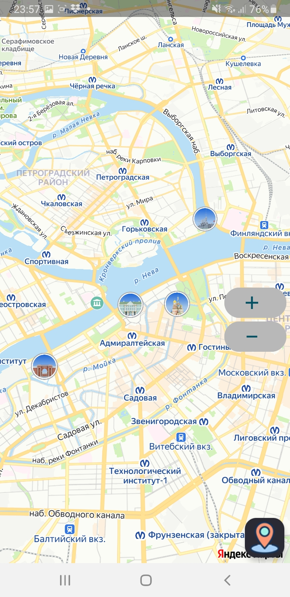

## YanMaps - мини-проект по работе с API Яндекс Карт.

**Цель:** изучение и практическое применение Yandex MapKit для отображения интерактивных карт, маркеров и пользовательских меток.

**Что реализовано:**
- Интеграция MapKit в Android-приложение
- Создание маркеров по нажатию на карту (диалог с предложением создать метку)
- Сохранение маркеров между запусками приложения
- **Список маркеров** (RecyclerView) с названиями; нажатие на элемент переводит к соответствующей метке на карте
- **Управление маркерами** — при нажатии на существующий маркер открывается диалог с удалением или редактированием названия

**Демонстрация:**

  

**Экраны:**

  
  
  

**Стек:** Kotlin, Yandex MapKit.
